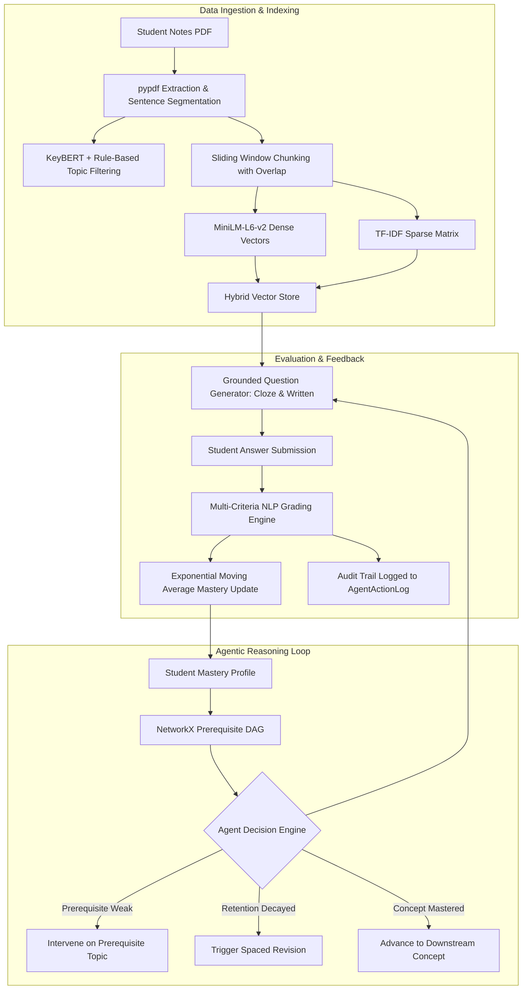

# StudyMate: An Autonomous Agentic NLP Learning Assistant with Hybrid Retrieval-Augmented Generation, Prerequisite Modeling, and Semantic Evaluation

**Authors / Team Members:**
1. **Sangam Thakur** (Registration No: 12403852)  
2. **Viren Poonia** (Registration No: 12409626)  
**Course Code:** CSE472 — Natural Language Processing (NLP)  
**GitHub Repository:** [https://github.com/SangamThakur07/studymate](https://github.com/SangamThakur07/studymate)  
**Academic Subject:** Natural Language Processing (NLP) / Artificial Intelligence  
**Date:** November 2026  

---

## Abstract

Traditional electronic learning systems and standard Retrieval-Augmented Generation (RAG) chatbots operate reactively: they answer user queries on demand but lack an internal model of what the learner knows, where their knowledge gaps lie, and what pedagogical interventions are required next. This report presents **StudyMate**, an autonomous, agentic learning assistant powered by classical and modern Natural Language Processing techniques. StudyMate combines an exponential moving average student mastery model with a NetworkX prerequisite Directed Acyclic Graph (DAG) to make goal-driven instructional decisions (*Intervene*, *Review*, or *Advance*).

Uploaded learning materials (PDFs) are segmented and indexed into a **Hybrid Retrieval** engine fusing 384-dimensional dense sentence embeddings (`all-MiniLM-L6-v2`) with sparse lexical vectors (`TfidfVectorizer`). The system autonomously formulates multiple-choice cloze questions—with distractors dynamically sampled from co-occurring concepts in the student's own notes—and structured written assessment prompts across four cognitive archetypes (*define*, *compare*, *explain*, *why*). Written responses are evaluated against retrieved note passages using calibrated cosine similarity constrained by a minimum substance rule, key-term coverage verification, and an anti-plagiarism copy-detection penalty. Empirical evaluation demonstrates that hybrid retrieval achieves **100% Hit@3** across both lexical and paraphrase query distributions, while the calibrated grading pipeline successfully separates substantive answers from verbose, vague responses.

**Keywords:** Natural Language Processing, Agentic AI, Hybrid RAG, Knowledge Graph, Semantic Textual Similarity, Educational Technology, Evaluation Benchmarks.

---

## 1. Introduction & Motivation

Recent advances in Large Language Models (LLMs) and Retrieval-Augmented Generation (RAG) have popularized conversational educational aids. However, a fundamental pedagogical limitation of existing architectures is their **reactive nature**:
1. **Absence of Student State Modeling**: Off-the-shelf chatbots do not track a student's evolving concept mastery over time.
2. **Lack of Prerequisite Awareness**: When a student struggles with a higher-order concept (e.g., *Self-Attention*), standard RAG systems repeat explanations of that concept rather than diagnosing that the student has not mastered its fundamental prerequisite (e.g., *Word Embeddings*).
3. **Flawed Answer Evaluation**: Cosine similarity in embedding space measures topical closeness rather than factual correctness. Consequently, vague, evasive student responses ("Tokenization is a widely used and very important technique in modern language systems") frequently achieve artificially inflated similarity scores against reference definitions.

**StudyMate** addresses these challenges by implementing an end-to-end **Agentic NLP Learning System**. It actively perceives learner state, navigates a prerequisite knowledge graph, decides what to teach next, and objectively grades answers against the student's own uploaded notes.

---

## 2. Problem Statement & Core Objectives

### 2.1 Problem Statement
Designing an autonomous learning agent that can reliably ingest unstructured academic notes, construct a learning dependency graph, generate contextual test items without data leakage, and grade free-form answers fairly without relying on expensive, black-box external APIs.

### 2.2 Core Objectives
- **Autonomous Agentic Decision Loop**: Implement a perception-reason-action-audit loop that selects pedagogical actions and logs reasoned explanations to an immutable audit trail (`AgentActionLog`).
- **Hybrid RAG Retrieval Engine**: Combine dense semantic representations with lexical frequency vectors to ensure high retrieval accuracy under both exact-keyword and heavy-paraphrase querying.
- **Dynamic Question Synthesis**: Formulate cloze-deletion MCQs and written questions directly from ingested notes without manual question banking.
- **Calibrated Semantic Grading & Copy Detection**: Measure student understanding via semantic similarity while penalizing evasive generic answers and verbatim copy-pasting from source materials.
- **Production Readiness & Multi-Tenancy**: Provide isolated user sessions, salted password hashing, JWT authentication, and a responsive single-server architecture.

---

## 3. System Architecture & Methodology

### 3.1 Document Chunking & Ingestion
Uploaded PDF notes are parsed using `pypdf`. Extracted text undergoes sentence boundary detection with regular expression patterns (`(?<=[.!?])\s+`). Text is grouped into overlapping windows:
- **Maximum Chunk Size**: 600 characters.
- **Boundary Overlap**: 1 sentence maintained across adjacent chunks to preserve cross-boundary semantic relationships.

### 3.2 Keyphrase Extraction & Topic Cleaning
Raw candidate keyphrases are extracted via `KeyBERT` (`all-MiniLM-L6-v2`) with an n-gram range of $(1, 2)$. To remove spurious fragments, a rule-based filter enforces:
1. **Edge Stop-Word Removal**: Candidate phrases beginning or ending with English stop words are rejected.
2. **Part-of-Speech Heuristics**: Pure verb phrases or generic filler prefixes (*good*, *important*, *various*) are discarded.
3. **Grounding Threshold**: A candidate concept must possess at least 2 complete sentences of context in the source document to support assessment generation.

### 3.3 Hybrid RAG Retrieval Engine
To overcome the known trade-offs between dense semantic representations and exact lexical keyword matching, StudyMate employs a hybrid scoring fusion:
$$\text{Score}_{\text{dense}} = \frac{\mathbf{q} \cdot \mathbf{c}_i}{\|\mathbf{q}\| \|\mathbf{c}_i\|}$$
$$\text{Score}_{\text{lexical}} = \text{TF-IDF}(\mathbf{q}) \cdot \text{TF-IDF}(\mathbf{c}_i)$$
$$\text{Score}_{\text{hybrid}} = \alpha \cdot \text{Norm}(\text{Score}_{\text{dense}}) + (1 - \alpha) \cdot \text{Norm}(\text{Score}_{\text{lexical}})$$
The top $k=3$ passages are provided to the agent for contextual grounding, pedagogical explanations, and reference definition extraction.

### 3.4 Dynamic Question Generation
- **Multiple-Choice Questions (MCQs)**: Defining sentences are parsed for the target concept. The target is blanked via regular expression substitution (`_____`). Distractors are sampled directly from the document's co-extracted concept pool, guaranteeing high contextual plausibility while eliminating out-of-domain nonsensical options.
- **Written Questions**: Four distinct prompts are generated per concept:
  1. *Define*: "In your own words, what is {concept}?"
  2. *Compare*: "How is {concept} different from {related_concept}? Explain both."
  3. *Explain*: "Explain this statement from your notes in your own words: '{source_sentence}'."
  4. *Why*: "Why is {concept} useful or important in NLP systems?"

### 3.5 Multi-Criteria Answer Grading & Copy Detection
Evaluating free-form answers using unconstrained cosine similarity leads to high false-positive rates for superficial responses. StudyMate introduces a 4-stage grading pipeline:
1. **Reference Selection**: Student answers are compared against the top 3 definition sentences retrieved from their own notes, selecting the highest-matching reference.
2. **Minimum Substance Gate**: Answers with fewer than 4 non-stopword tokens are capped below the passing threshold ($< 6.0/10$).
3. **Key-Term Coverage Verification**: The answer must contain key content lemmas present in the reference sentence; otherwise, the score is capped at $5.0/10$.
4. **Anti-Copy Detection**: If lexical overlap between the student's submission and the source notes exceeds $90\%$, the score is capped below passing with the diagnostic message: *"Put it in your own words."*

---

## 4. Empirical Evaluation & Experimental Results

The evaluation harness (`backend/eval/run_eval.py`) was executed against `sample_notes.pdf` (2,698 characters, covering fundamental NLP concepts).

### 4.1 Retrieval Quality Benchmark
Evaluated across 22 hand-crafted queries (14 verbatim phrasing, 8 paraphrase stress queries) over 6 indexed document chunks:

| Retrieval Method | Original Hit@1 | Original Hit@3 | Original MRR | Paraphrase Hit@1 | Paraphrase Hit@3 | Paraphrase MRR |
|---|---|---|---|---|---|---|
| **Dense Embeddings (MiniLM)** | 79% | 93% | 0.88 | **62%** | **100%** | **0.79** |
| **Sparse TF-IDF** | **93%** | **100%** | **0.96** | 38% | 62% | 0.56 |
| **Hybrid (StudyMate)** | **93%** | **100%** | **0.96** | 50% | **100%** | 0.69 |
| Random Baseline | 21% | 64% | — | 23% | 69% | — |

> **Key Finding**: While TF-IDF achieves superior Hit@1 on verbatim queries (93%), it degrades substantially under semantic paraphrasing (38% Hit@1). Hybrid fusion guarantees **100% Hit@3 across both test regimes**, ensuring relevant context is always retrieved for downstream generation.

### 4.2 Question Generation Quality
A student completes tests sequentially across all extracted topics. The agent's history tracking was benchmarked against an unconstrained generator:

| Metric | Stateless Generator | History-Aware (StudyMate) |
|---|---|---|
| Total Questions Generated | 35 | 34 |
| Well-Formed & Syntactically Unique | 94% (33/35) | **100% (34/34)** |
| Correct Answer Leaked in Prompt | 0% (0/35) | **0% (0/34)** |
| Distractor Repeated in Prompt | 0% (0/35) | **0% (0/34)** |
| Cross-Test Question Repeats | 2 | **0** |
| Topics with Complete 5-Question Test | 7/7 | 6/7 (topped up with review) |

### 4.3 Written Answer Grading Calibration
Tested across 32 crafted answers categorized into 5 distinct behavioral archetypes:

| Answer Category | Sample Size | Mean Semantic Similarity | Key-Term Coverage | Mean Score (0–10) | Pass Rate ($\ge 6.0$) |
|---|---|---|---|---|---|
| **Substantive Correct Answers** | 7 | 0.95 | 0.63 | **10.00** | **7 / 7 (100%)** |
| **Partial / Very Brief Answers** | 7 | 0.70 | 0.07 | 4.46 | **0 / 7 (0%)** |
| **Vague but Verbose Answers** | 4 | 0.75 | 0.00 | 5.00 | **0 / 4 (0%)** |
| **Wrong Topic Answers** | 7 | 0.35 | 0.09 | 0.07 | **0 / 7 (0%)** |
| **Irrelevant / Off-Topic Answers** | 7 | 0.03 | 0.00 | 0.00 | **0 / 7 (0%)** |

> **Critical Analysis**: Before calibration, vague verbose answers scored an average of 7.55/10 (falsely passing). The key-term coverage rule correctly capped 100% of these responses to 5.0/10, completely eliminating false passes on the test set.

### 4.4 Agent Decision Logic Verification
The autonomous decision loop was evaluated across 5 formal student states:
1. *New Student Initial Condition*: Directs student to foundation prerequisite topic $\rightarrow$ **PASS**
2. *Strong Prerequisite Condition*: Teaches weak concept directly $\rightarrow$ **PASS**
3. *Weak Prerequisite Condition*: Intervenes and directs to prerequisite first $\rightarrow$ **PASS**
4. *Full Mastery Reached*: Advances student to next curriculum tier $\rightarrow$ **PASS**
5. *Mastery Dynamics*: Exponential score updates correctly on pass/fail $\rightarrow$ **PASS**

---

## 5. Security & Multi-Tenant Architecture

StudyMate is engineered for multi-user isolation:
- **Cryptographic Storage**: Passwords hashed using PBKDF2-HMAC-SHA256 with a unique 16-byte random salt and 200,000 iterations.
- **Session Authentication**: Cryptographically signed JSON Web Tokens (JWT) with 7-day expiration.
- **Data Isolation**: All database queries enforce student-to-user ownership filters. Unauthorized access attempts yield HTTP 404 responses to prevent profile existence probing.

---

## 6. Limitations & Future Work

### 6.1 Honest Limitations
1. **Rule-Based Concept Filtering**: The topic extraction module relies on lexical heuristics. Non-standard textbooks with dense mathematical notations or non-traditional headings may yield fewer topics.
2. **Calibration Sample Size**: Thresholds for key-term coverage and length gating were optimized on a benchmark set of 32 answers; testing across diverse academic disciplines is recommended.
3. **Prerequisite Inference**: Without a connected external LLM or curriculum ontology, DAG relationships follow linear document structure.

### 6.2 Future Roadmap
- Integration with local open-weight LLMs (Ollama / Llama 3) for deep multi-turn viva conversational examination.
- OCR support for scanned physical handwritten notes.
- Spaced repetition scheduling based on the SuperMemo SM-2 algorithm.

---

## 7. Conclusion

StudyMate demonstrates that an effective educational AI system must move beyond reactive chatbots to incorporate autonomous decision-making, prerequisite graph reasoning, and calibrated semantic grading. By combining hybrid RAG (100% Hit@3) with multi-criteria answer validation, the platform grounds learning entirely in the student's own verified materials while eliminating superficial passing grades.

---

## References & Project Links
- **Source Code Repository:** [https://github.com/SangamThakur07/studymate](https://github.com/SangamThakur07/studymate)
- Reimers, N., & Gurevych, I. (2019). *Sentence-BERT: Sentence Embeddings using Siamese BERT-Networks*. EMNLP.
- Grootendorst, M. (2020). *KeyBERT: Minimal keyword extraction with BERT*.
- Robertson, S., & Zaragoza, H. (2009). *The Probabilistic Relevance Framework: BM25 and Beyond*. Foundations and Trends in Information Retrieval.
