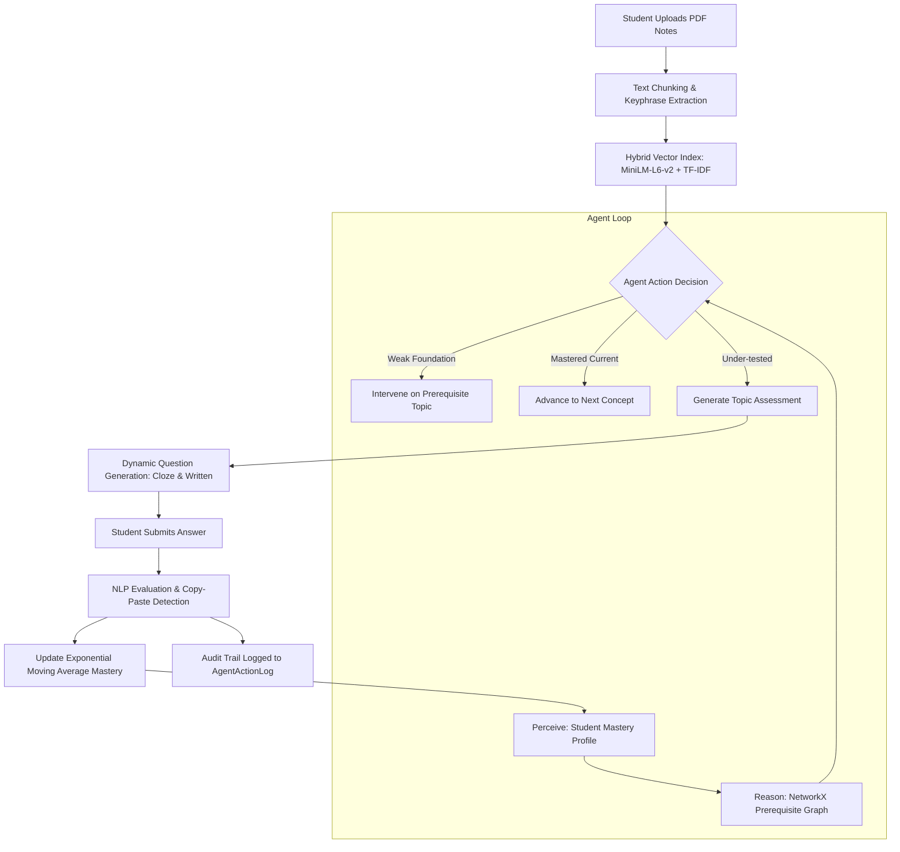

# StudyMate — Agentic NLP-Driven Study Assistant

An autonomous, agentic learning system powered by Natural Language Processing (NLP). StudyMate builds an internal profile of student mastery, reasons over a prerequisite knowledge graph, and decides what concept to teach next. It indexes the student's own uploaded notes using **Hybrid RAG** (Dense Embeddings + Lexical TF-IDF), generates dynamic cloze and written test questions, and evaluates student answers via semantic similarity with anti-plagiarism penalty checks.

---

## 🏗️ Architecture & Agent Decision Loop



---

## 🧠 NLP Pipeline Stages

1. **Document Processing & Chunking** (`material_tools.py`, `rag_tools.py`):
   - PDF extraction via `pypdf`.
   - Sentence boundary detection and chunking into 600-character windows with 1-sentence overlap to preserve semantic context across boundaries.
2. **Keyphrase & Concept Extraction** (`knowledge_tools.py`, `topic_tools.py`):
   - Dense keyphrase extraction using `KeyBERT` (`all-MiniLM-L6-v2`) with fallback to n-gram TF-IDF.
   - Heuristic filtering: removes stop-word edges, filters non-noun verb phrases, and requires at least 2 sentences of grounding in the document.
3. **Hybrid Retrieval (RAG)** (`rag_tools.py`):
   - Dense embeddings: `sentence-transformers/all-MiniLM-L6-v2` (384-dimensional dense vectors).
   - Sparse lexical: `TfidfVectorizer` (sublinear term frequency).
   - Hybrid fusion combining normalized dense cosine similarity and sparse TF-IDF scores.
4. **Question Generation** (`mcq_tools.py`):
   - **Multiple-Choice Questions (MCQs)**: Cloze deletion on defining sentences; distractors dynamically sampled from related concepts within the student's own notes.
   - **Written Questions**: 4 question archetypes (*define*, *compare*, *explain*, *why*).
5. **Answer Evaluation & Plagiarism/Copy Detection** (`evaluation_tools.py`):
   - Evaluated against the top-3 reference definition sentences retrieved from the student's notes.
   - Calibrated cosine similarity + minimum substance threshold (>= 4 meaningful words).
   - Key-term coverage verification to penalize vague answers.
   - **Copy detection penalty**: answers with near-exact word-for-word overlap with source notes are capped below pass mark ("Put it in your own words").

---

## 📊 Evaluation & Empirical Results

Evaluated on `sample_notes.pdf` using the automated test suite in `backend/eval/run_eval.py`:

### 1. Retrieval Quality (22 Hand-Crafted Questions across 6 Passages)
*Original questions reuse phrasing from the notes; Paraphrase stress questions share minimal lexical overlap.*

| Method | Original Hit@1 | Original Hit@3 | Original MRR | Paraphrase Hit@1 | Paraphrase Hit@3 | Paraphrase MRR |
|---|---|---|---|---|---|---|
| **Embeddings (MiniLM)** | 79% | 93% | 0.88 | **62%** | **100%** | **0.79** |
| **TF-IDF (Lexical)** | **93%** | **100%** | **0.96** | 38% | 62% | 0.56 |
| **Hybrid (Fused)** | **93%** | **100%** | **0.96** | 50% | **100%** | 0.69 |
| Random Baseline | 21% | 64% | — | 23% | 69% | — |

> **Key Finding**: While TF-IDF excels when query words match the document verbatim, dense embeddings dominate under heavy paraphrasing. Hybrid retrieval achieves 100% Hit@3 across both test regimes.

### 2. Question Generation Quality
| Metric | Without History | History-Aware (StudyMate) |
|---|---|---|
| Questions Generated | 35 | 34 |
| Well-formed & Unique | 94% (33/35) | **100% (34/34)** |
| Correct Answer Visible in Prompt | 0 | 0 |
| Repeated Questions Across Sessions | 2 | **0** |
| Topics with Full 5-Question Test | 7/7 | 6/7 (topped up with review) |

### 3. Written Answer Grading
| Answer Type | Sample Size | Mean Semantic Similarity | Key-Term Coverage | Mean Score (0–10) | Pass Rate (>= 6) |
|---|---|---|---|---|---|
| **Good Answers** | 7 | 0.95 | 0.63 | **10.00** | **7 / 7 (100%)** |
| **Partial / Very Short** | 7 | 0.70 | 0.07 | 4.46 | **0 / 7 (0%)** |
| **Vague but Verbose** | 4 | 0.75 | 0.00 | 5.00 | **0 / 4 (0%)** |
| **Wrong Topic** | 7 | 0.35 | 0.09 | 0.07 | **0 / 7 (0%)** |
| **Irrelevant / Off-Topic** | 7 | 0.03 | 0.00 | 0.00 | **0 / 7 (0%)** |

---

## 🚀 Quickstart & Local Setup

### Option 1: Automated Launcher (Windows)
Double-click `start_shared.bat`. This automatically:
1. Builds the React frontend production bundle.
2. Activates the Python virtual environment.
3. Serves the full single-server application on `http://localhost:8000`.

### Option 2: Manual Terminal Execution
```bash
# 1. Frontend Build
cd frontend
npm install
npm run build

# 2. Backend Server
cd ../backend
python -m venv venv
venv\Scripts\activate
pip install -r requirements.txt
uvicorn app.main:app --host 0.0.0.0 --port 8000
```

Open `http://localhost:8000` in your web browser.

---

## 🔒 Security & Data Isolation
- **Authentication**: JWT tokens (HS256) with 7-day validity.
- **Password Protection**: Salted PBKDF2-HMAC-SHA256 with 200,000 iterations.
- **Multi-Tenant Isolation**: Students only access their own notes, extracted topics, and mastery records.
